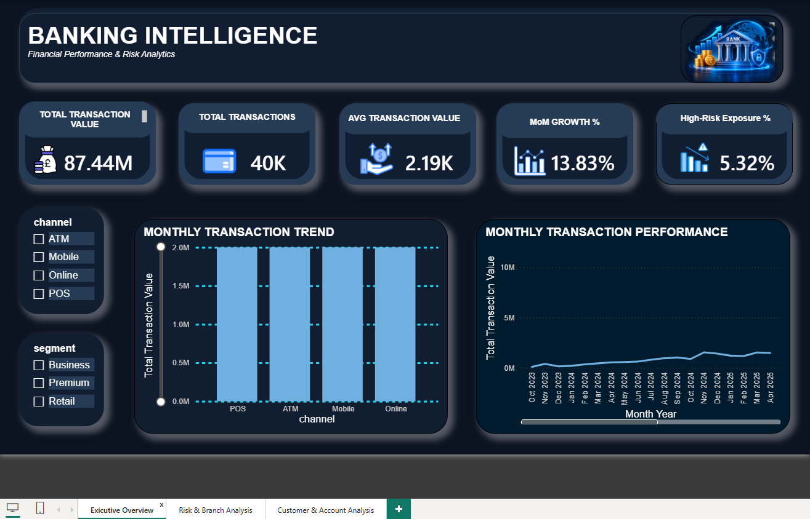
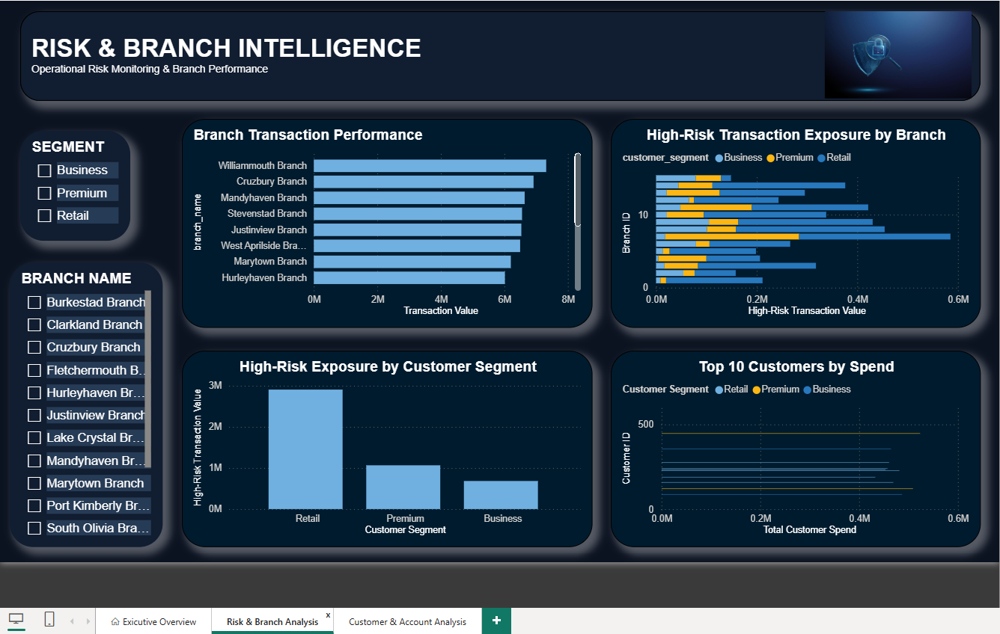
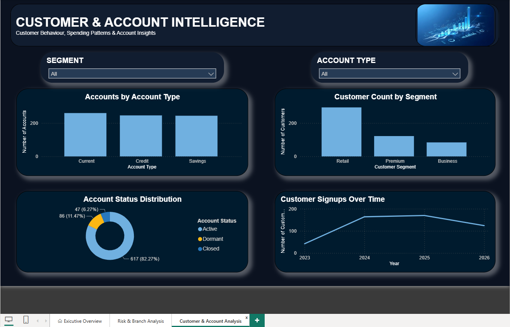

# 🏦 BANKS – Banking Data Analytics Project

## 📌 Project Overview

This project focuses on analyzing banking data to understand transaction performance, customer behavior, branch performance, and financial risk exposure.

The project uses SQL, Python, and Power BI to transform raw banking data into meaningful business insights through interactive dashboards.

## 🛠️ Tools & Technologies

- **MySQL** – Database management and SQL analysis
- **Python** – Data preparation and analysis
- **Power BI** – Interactive dashboards and data visualization
- **Excel / CSV** – Data storage

## 🎯 Business Questions

This project answers important business questions:

- What is the total transaction value and transaction count?
- How does transaction performance change month by month?
- Which branches generate the highest transaction value?
- Which customers have the highest spending?
- How are customers distributed across different segments?
- What is the high-risk transaction exposure?
- How do account types and account statuses vary?
- How does customer signup activity change over time?

## 🔍 SQL Analysis

SQL was used to perform:

- Data extraction and filtering
- Table joins
- Aggregations and grouping
- Customer spending analysis
- Monthly transaction analysis
- Branch performance analysis
- Transaction channel analysis
- Customer spend ranking
- High-risk exposure analysis
- CTEs and window functions
- Creation of analytical views

## 📊 Power BI Dashboard

An interactive 3-page Power BI dashboard was developed to monitor banking performance and generate business insights.

### Page 1 – Executive Overview

- Total Transaction Value
- Total Transactions
- Average Transaction Value
- Month-over-Month Growth
- High-Risk Exposure
- Monthly Transaction Trend
- Monthly Transaction Analysis
- Channel and Customer Segment filters

### Page 2 – Risk & Branch Analysis

- Branch Transaction Performance
- High-Risk Transaction Value by Branch
- High-Risk Exposure by Customer Segment
- Top 10 Customers by Spend
- Branch and Customer Segment filters

### Page 3 – Customer & Account Intelligence

- Accounts by Account Type
- Customer Count by Segment
- Account Status Distribution
- Customer Signups Over Time
- Customer Segment and Account Type filters

## 📸 Dashboard Screenshots

### 1. Executive Overview



### 2. Risk & Branch Analysis



### 3. Customer & Account Intelligence



## 📁 Project Structure

```text
BANKS-Data-Analytics-Project
│
├── Screenshots
│   ├── Executive_Overview.png
│   ├── Risk_Branch_Analysis.png
│   └── Customer_Account_Intelligence.png
│
├── Power BI
│   └── BANKS_PROJECT_DASHBOARD.pbix
│
├── SQL
│   └── BANK_ANALYSIS_PROJECT.sql
│
└── Data
    ├── Accounts.bank.csv
    ├── Branches.Bank.csv
    ├── Customers.Bank.csv
    ├── Merchants.bank.csv
    └── Transactions.Bank.csv
```

## 💡 Skills Demonstrated

- SQL and MySQL
- Python
- Data Cleaning and Preparation
- Data Analysis
- Data Visualization
- Power BI Dashboard Development
- DAX Measures and KPIs
- Business Intelligence
- Analytical Thinking

## 👤 Author

**Sanjay S**

Aspiring Data Analyst

**Skills:** SQL | Python | Power BI | Excel
